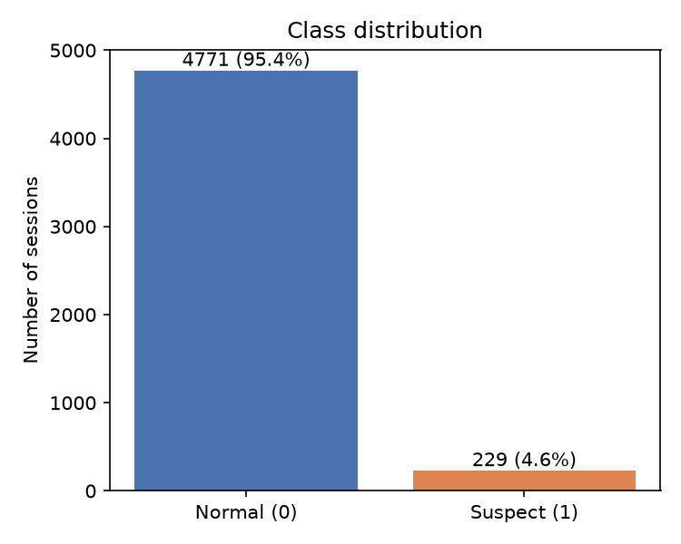
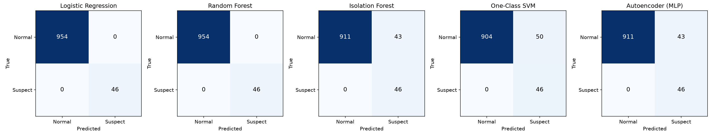
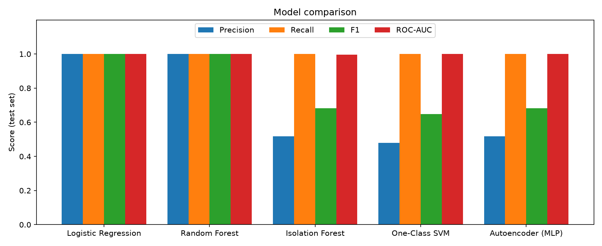
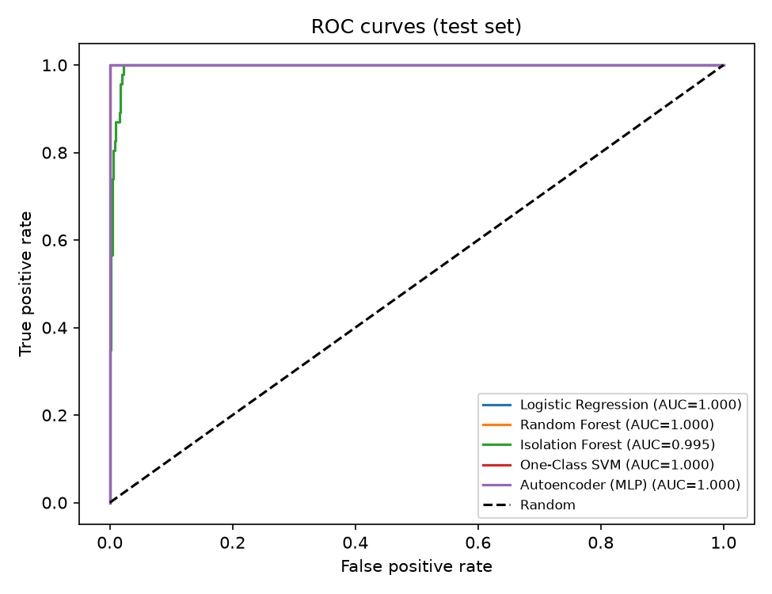
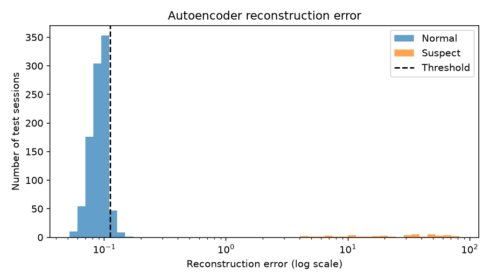
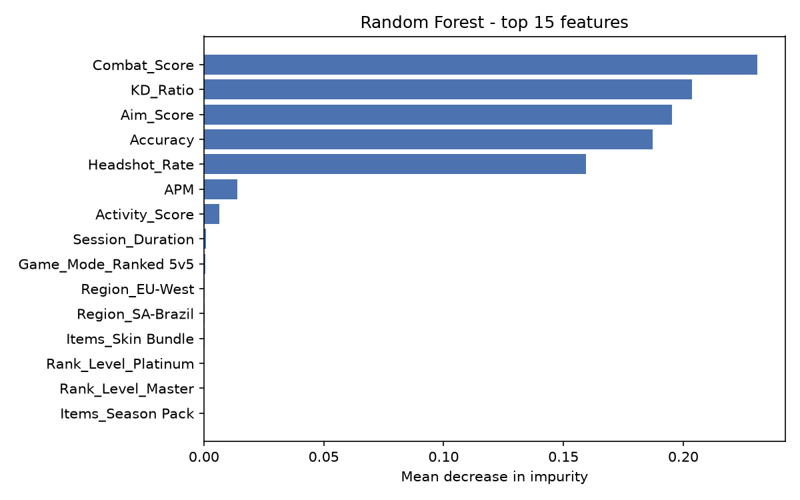

# Game Cheat Detection — supervised vs. anomaly-detection models

Machine-learning pipeline that flags suspicious players in an online shooter from their
in-game behaviour (aim accuracy, headshot rate, K/D ratio, APM…). It compares two
**supervised** classifiers with three **unsupervised anomaly detectors** that never see a
cheater during training.

> Group project, Master *Ingénierie et data analytique appliquée à l'industrie du gaming*
> (ENS Fès, Morocco) — **Ilyas Benderrou, Akram Atrari, Marwane Nouhass**.
> This repository is the cleaned, reproducible version of our original notebook
> (`notebooks/Projet4_AntiCheat_FINAL.ipynb`).

## Goal

Given one game session, predict whether the player is cheating (`Cheat_Likelihood = 1`)
and understand which behavioural signals give cheaters away — while being honest about
how far these results transfer to a real anti-cheat system.

## Data

| | |
|---|---|
| Dataset | Kaggle — **"Online Gaming Behavior and Cheating Metrics"** |
| File | `online_gaming_behavior.csv` (not included, see [`data/README.md`](data/README.md)) |
| Size | 5,000 sessions, 12 columns |
| Target | `Cheat_Likelihood`: 4,771 normal (95.4 %) / 229 suspect (4.6 %) |

Columns: game mode, region, rank, session duration, APM (actions per minute), K/D ratio,
accuracy, headshot rate, purchased item, label. The dataset appears to be synthetic
(see *Limitations*).



## Method

1. **Cleaning** — 1,049 sessions have no `Items` value (the raw file contains the string
   `None`, which pandas reads as missing). They are kept and labelled `No_Item`.
2. **Feature engineering**
   - `Aim_Score = Accuracy × Headshot_Rate`
   - `Combat_Score = KD_Ratio × Accuracy`
   - `Activity_Score = APM / Session_Duration`
3. **Pre-processing** — IDs dropped, numeric features standardised, categorical features
   one-hot encoded, **stratified 80/20 split** (4,000 train / 1,000 test, 46 suspects in test).
4. **Models**
   | Model | Type | Training data |
   |---|---|---|
   | Logistic Regression (`class_weight="balanced"`) | supervised | all training sessions |
   | Random Forest (300 trees, balanced) | supervised | all training sessions |
   | Isolation Forest (300 trees) | anomaly detection | **normal players only** |
   | One-Class SVM (RBF kernel) | anomaly detection | **normal players only** |
   | MLP autoencoder (16-8-16) | anomaly detection (reconstruction error) | **normal players only** |

   For the three detectors, the alert threshold is set so that ~4.6 % of *normal training
   players* would be flagged (the cheater ratio of the training set).
5. **Evaluation** — accuracy, precision, recall, F1, ROC-AUC (from probabilities or anomaly
   scores), confusion matrices, Random Forest feature importance.
6. **Robustness checks** — 5-fold stratified cross-validation of the supervised models, and an
   **ablation** that removes the aim/combat features to see what is left.

## Results (test set, 1,000 sessions — produced by `src/anticheat_pipeline.py`)

| Model | Precision | Recall | F1 | ROC-AUC | TN / FP / FN / TP |
|---|---:|---:|---:|---:|---|
| Logistic Regression | 1.000 | 1.000 | 1.000 | 1.000 | 954 / 0 / 0 / 46 |
| Random Forest | 1.000 | 1.000 | 1.000 | 1.000 | 954 / 0 / 0 / 46 |
| Isolation Forest | 0.517 | 1.000 | 0.682 | 0.995 | 911 / 43 / 0 / 46 |
| One-Class SVM | 0.479 | 1.000 | 0.648 | 1.000 | 904 / 50 / 0 / 46 |
| Autoencoder (MLP) | 0.517 | 1.000 | 0.682 | 1.000 | 911 / 43 / 0 / 46 |

5-fold cross-validation confirms the supervised scores: precision, recall, F1 and ROC-AUC
are all **1.000 (std 0.000)** for both Logistic Regression and Random Forest.





**Reading the unsupervised results.** All three detectors catch every cheater (recall 1.0)
and rank sessions almost perfectly (ROC-AUC ≥ 0.995). Their precision is only ~0.5 because
of the *threshold rule*, not the model: we deliberately flag the 4.6 % most unusual
*normal* players, so ~43–50 honest players are flagged in the test set. With labels, a
better threshold could be picked; without labels, this trade-off (more false alarms vs.
missed cheaters) is exactly what a moderation team has to decide.



**Which features matter?** The five aim/combat features carry ~98 % of the Random Forest
importance (Combat_Score 0.231, KD_Ratio 0.204, Aim_Score 0.195, Accuracy 0.187,
Headshot_Rate 0.159); APM follows far behind (0.014).



## Limitations — why 100 % should not be trusted

The perfect supervised scores are **real outputs of the code, but they are too good to be
meaningful**. The script checks it explicitly (`outputs/separability_check.csv`):

| Feature | Normal range | Suspect range |
|---|---|---|
| KD_Ratio | 0.50 – 3.00 | 5.09 – 19.92 |
| Accuracy | 0.20 – 0.50 | 0.80 – 0.99 |
| Headshot_Rate | 0.10 – 0.40 | 0.80 – 1.00 |

The two classes **do not overlap at all**: a single rule such as `Accuracy > 0.65` separates
them perfectly. The dataset is very likely synthetic, generated with disjoint ranges per class.

What happens if we remove these "obvious" features (KD_Ratio, Accuracy, Headshot_Rate,
Aim_Score, Combat_Score) and keep only mode, region, rank, duration, APM, item and
Activity_Score? (`outputs/ablation_without_aim_features.csv`)

| Model (no aim features) | Precision | Recall | F1 | ROC-AUC |
|---|---:|---:|---:|---:|
| Logistic Regression | 0.073 | 0.609 | 0.130 | 0.698 |
| Random Forest | 0.239 | 0.348 | 0.283 | 0.745 |

Performance collapses: without absurd statistics, cheaters are hard to find. A real
anti-cheat system is much harder than this benchmark because:

- real cheaters use "closet" cheats (slightly boosted aim) that overlap with skilled players;
- labels are rare, noisy and delayed (bans, reports), and cheats evolve over time;
- useful signals are sequential (mouse trajectories, reaction times, per-shot data), not
  one aggregate row per session;
- false positives have a high cost (banning an honest, very good player).

Other limitations: one dataset, one random split (mitigated by cross-validation), and
no hyper-parameter tuning (unnecessary here given the separability).

## How to run

```bash
# from the project folder
python -m venv .venv
.venv\Scripts\activate          # Windows  (Linux/macOS: source .venv/bin/activate)
pip install -r requirements.txt
# put online_gaming_behavior.csv in data/ (see data/README.md)
python src/anticheat_pipeline.py
```

Runs in well under a minute on a laptop CPU. Outputs:
`figures/` (all plots), `outputs/` (metric tables, CSV), `models/` (trained models, git-ignored).

## Project structure

```
game-cheat-detection/
├── data/                  # put the Kaggle CSV here (git-ignored)
├── figures/               # generated plots
├── models/                # trained .joblib models (git-ignored)
├── notebooks/             # original exploratory notebook (French)
├── outputs/               # metric tables written by the script
├── src/anticheat_pipeline.py
├── requirements.txt
├── EXPLICATION_FR.md      # step-by-step explanation in French
└── README.md
```

## Authors

Ilyas Benderrou, Akram Atrari, Marwane Nouhass — ENS Fès.
